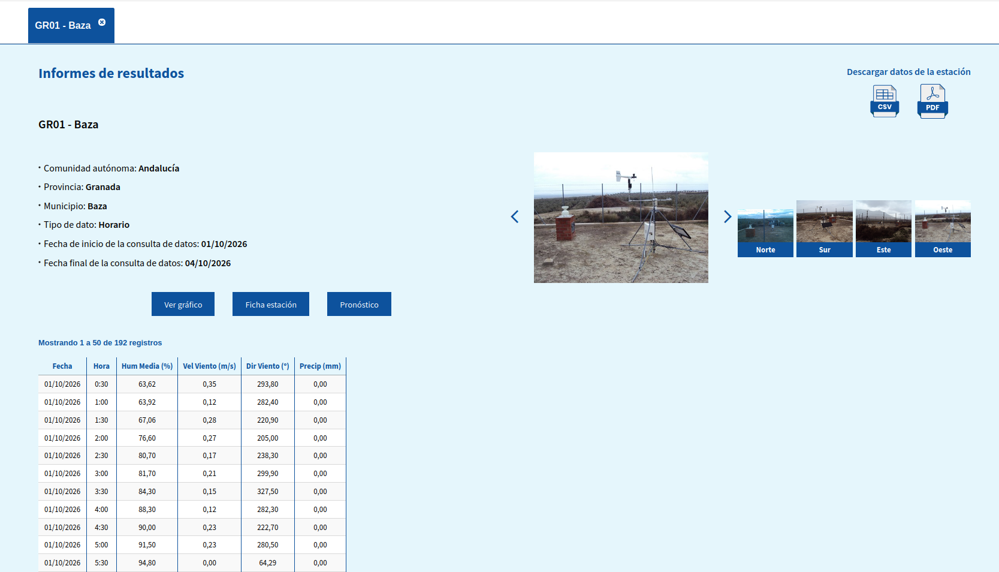
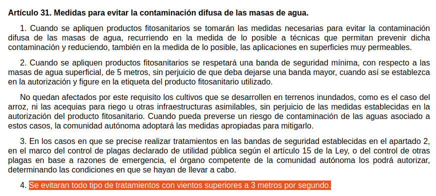
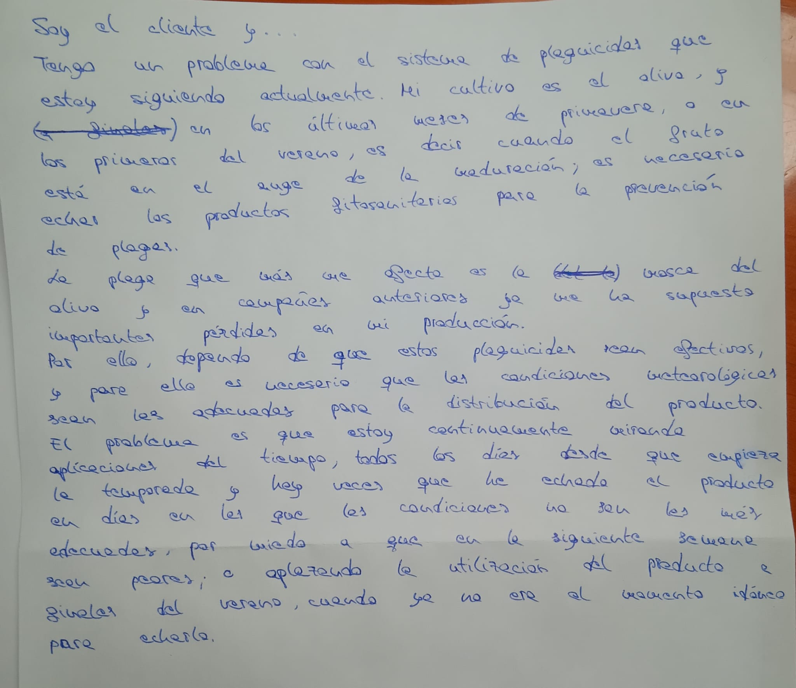
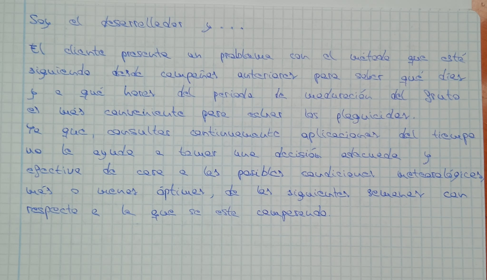
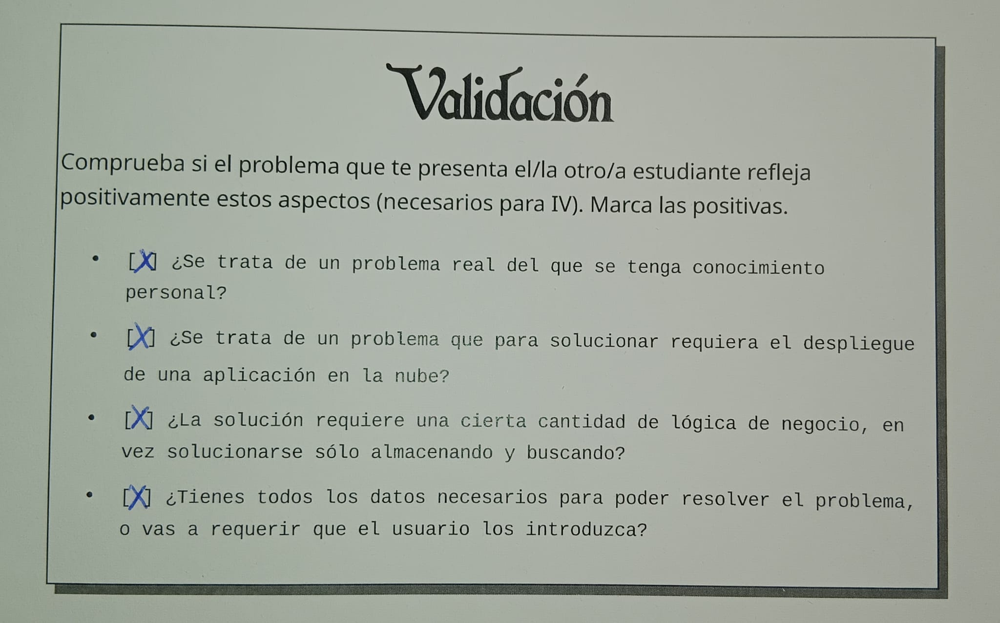

# OliveSky

Lucía Martín

## ¿Cuál es el problema?

Un agricultor del cultivo del olivo no puede saber en que días y a que horas del periodo de crecimiento del fruto es la más apropiada para la aplicación de productos (plaguicidas) que garanticen adecuadamente su maduración. Si no se aplica cuando es debido y como es debido perjudicará a la futura cosecha.

## ¿De dónde viene este problema?

Tengo un familiar que tiene una plantación de olivos en Baza, y para poder tener una cosecha óptima a finales de año, es necesario que el cuidado de la planta del olivo haya sido efectivo.
Para ello, a finales de la primavera o principios del verano, mi familiar aplica productos fitosanitarios para prevenir la aparición de plagas, y sobre todo, la mosca del olivo, que según mi familiar cada vez es más dañina y provoca más pérdidas en el periodo de recolección de la aceituna.
Al tener que trabajar con sustancias fitosanitarias mi familiar dispone del carné de productos fitosanitarios, y lleva a cabo las buenas prácticas para una buena aplicación. Estas buenas prácticas dependen de factores meteorológicos para garantizar la uniformidad en la distribución de los productos pulverizados, como es la humedad o la velocidad del viento.
En la última campaña le ha ocurrido que por miedo a aplicar el producto con rachas de viento desfavorables, lo pospuso y como resultado, terminó echando el producto a finales de verano, cuando no era la etapa cumbre del crecimiento del fruto, y cuando la mosca ya había atacado. 

## ¿Por qué es necesaria la implementación en la nube?

Porque la situación actual de mi familiar y el resto de agricultores dedicados al olivo, es mirar continuamente y manualmente aplicaciones del tiempo. Pero esto no es efectivo porque no garantiza la ejecución del producto en el momento preciso, como le ocurrió a mi familiar.
Esto le ocasiona a cada agricultor pérdida de tiempo y le puede ocasionar una gran pérdida de ganancias al final de la temporada.

Con una implementación en la nube, se ayudará a todos los agricultores de la misma zona, ya que tras haber obtenido en que días y a que horas es mejor la aplicación de dichos productos en sus periodos efectivos, el cálculo se haría una vez y se reutilizaría en fincas vecinas.

## ¿Cuáles son las fuentes de datos?

Los datos serán sacados del Sistema de Información Agroclimática para el Regadío, del Ministerio de Agricultura, Pesca y Alimentación dada una población.
En concreto se descargará de dicha web un CSV que contendrá información meteorológica semihoraria.

[Fuente 1](https://servicio.mapa.gob.es/siarweb/consultaDatos/consultaDatos)

Esta información se ha obtenido introduciendo en el SIAR lo siguiente: población, rango de fechas, parámetros(humedad media, velocidad del viento, dirección del viento, precipitaciones, temperatura), y frecuencia (semihoraria); que será lo necesario para conseguir los datos con los que se va a trabajar.

Además de guardar un CSV con la información relevante y determinante de las condiciones meteorológicas para la dispersión de productos pulverizados. 
Se encuentra en el BOE, Real Decreto 1311/2012, Uso sostenible de los productos fitosanitarios.

[Fuente 2](https://www.boe.es/buscar/act.php?id=BOE-A-2012-11605)

## ¿Cuál es la lógica de negocio?

Es necesario responder a una pregunta que se hace mi familiar y cualquier agricultor, ¿me espero a echar el plaguicida o no?

Para ello, se estudiará que hacer con esta pregunta dada una semana con un margen de los próximos 5 días, a partir de las condiciones meteorológicas de las semanas anteriores y de esa misma semana en campañas anteriores. 

La aplicación debería de recoger todas las lecturas semihorarias de información correspondiente a una población, quedándose con los parámetros claves para la uniformidad de la distribución del producto de las semanas mencionadas anteriormente, obteniéndolo del CSV de datos del SIAR.

Comprobará la integridad de dichos datos, descartando lecturas incoherentes ocasionadas por ejemplo con velocidades de viento negativas.

Filtrará esos datos, usando los límites establecidos; obteniéndolos del CSV escrito con las cifras de sostenibilidad de productos fitosanitarios, para considerar una entrada válida.

Recolectando los intervalos de media hora que cumplan aquellas condiciones y agruparlos en una posible ventana válida(6 intervalos = 3h). Dichos intervalos se considerarán aptos si hay almenos dos en los próximos 5 días

Con este histórico, se comparará el proceso de filtrado de los años anteriores, para ver que campaña se asemeja más a la actual dado el registro de condiciones atmosféricas (por ejemplo si es un año predominante de precipitaciones), cuáles fueron de toda la campaña anterior las horas y los días más óptimos y que decisión se tomó de cara a esa semana por la que se pregunta.

Contrastando así, el resultado obtenido de APLAZAR o NO APLAZAR el echar el plaguicida. Dandole peso realista, y ayudando con criterio a responder la toma de decisión en la que se encuentra el agricultor.

## Tarjeta Juego de rol

A continuación se encuentran las tarjetas de rol de cliente, desarrollador y de validación utilizadas para la obtención adecuada del problema.

## Archivo de documentación de la configuracion

A continuación se encuentra el archivo relacionado con la configuración del entorno.

[Configuración, Prerrequisitos](docs/configuracion.md)

## Planificación del Proyecto (Obj-1)
La planificación y los archivos relacionados con el OBJ-1 de las asignatura
se encuentran a continuación.
- [Personas](docs/personas.md)
- [User Journeys](docs/user_journeys.md)
- [Historias de Usuario](docs/historias_usuario.md)
- [Milestones](docs/milestones.md)
