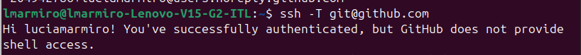

# Detalles de la configuracion del entorno

Se ha completado la equivalencia del nombre real, nick de GitHub(luciamarmiro) y de Telegram.

Se han configurado el par de claves SSH en GitHUb con mi usuario para la sincronización.

Se ha configurado un nombre con git config user.name y un email opcional con config.user email.

Se ha instalado correctamente el plugin de Git de l asignatura (git-iv)

A continuación se encuentran las tarjetas de rol de cliente, desarrollador y de validación utilizadas para la obtención adecuada del problema.

